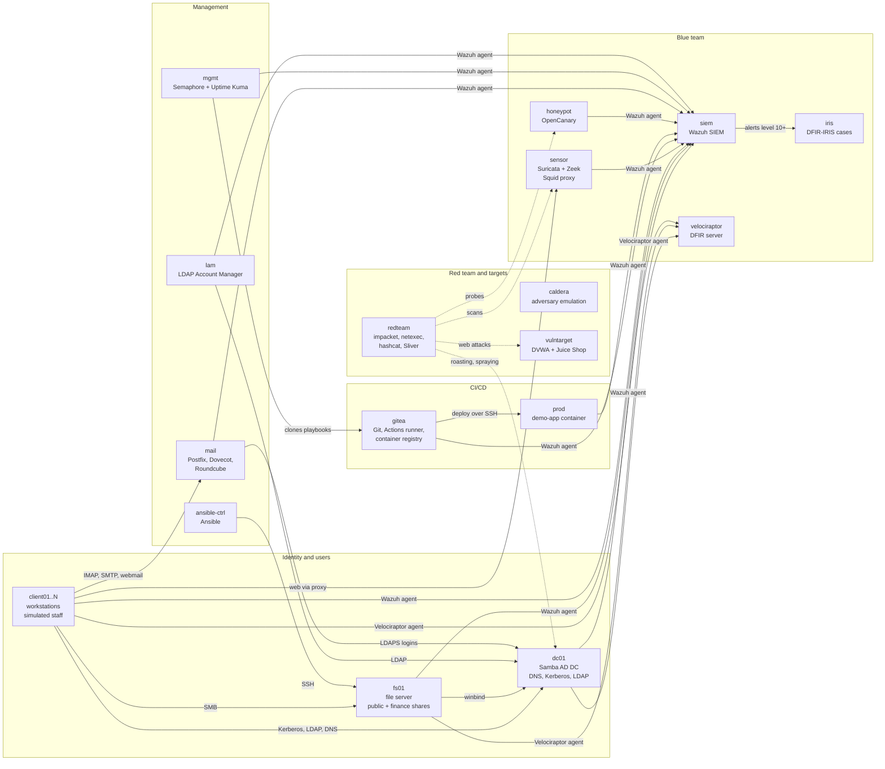
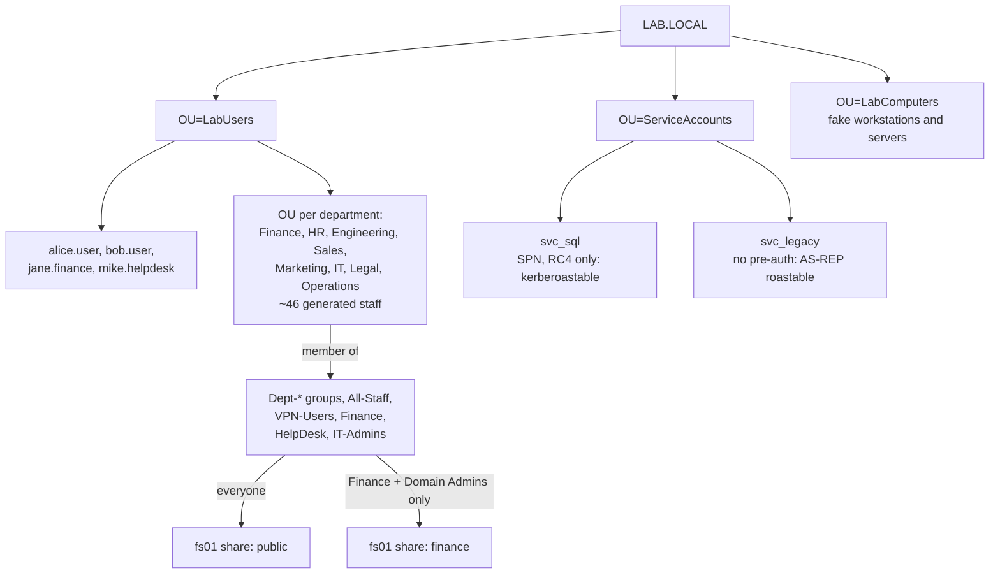
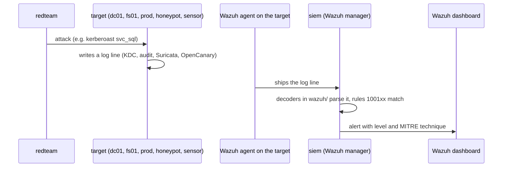
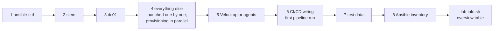
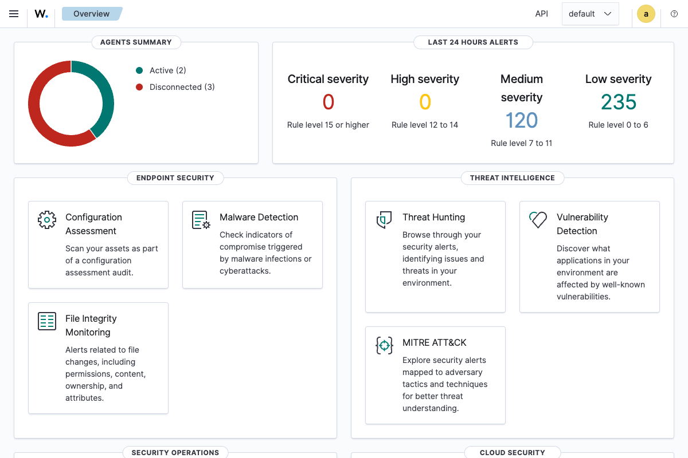
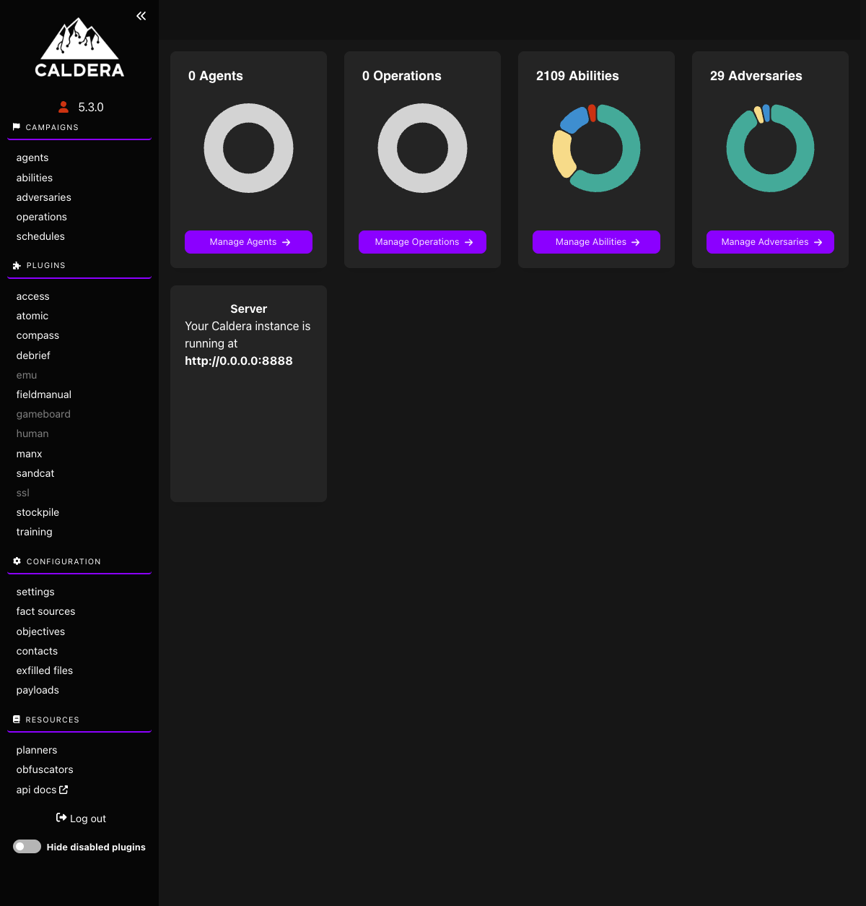
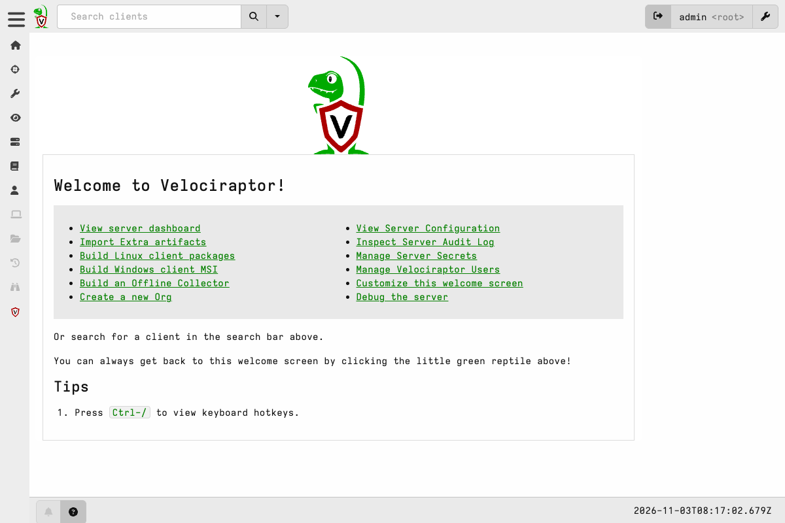
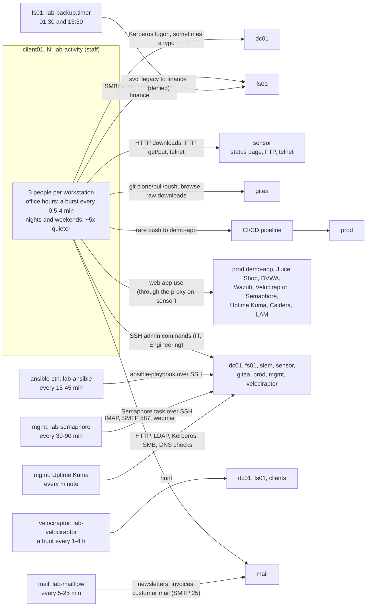
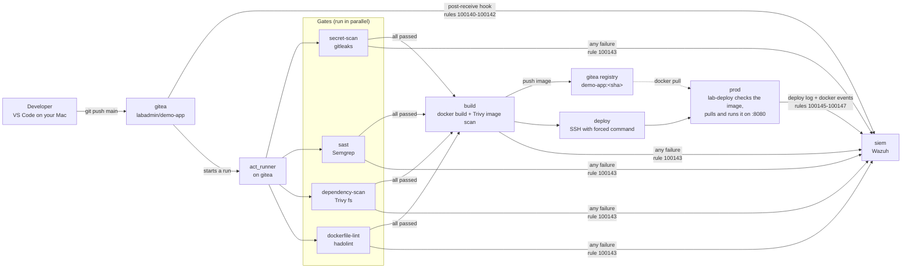
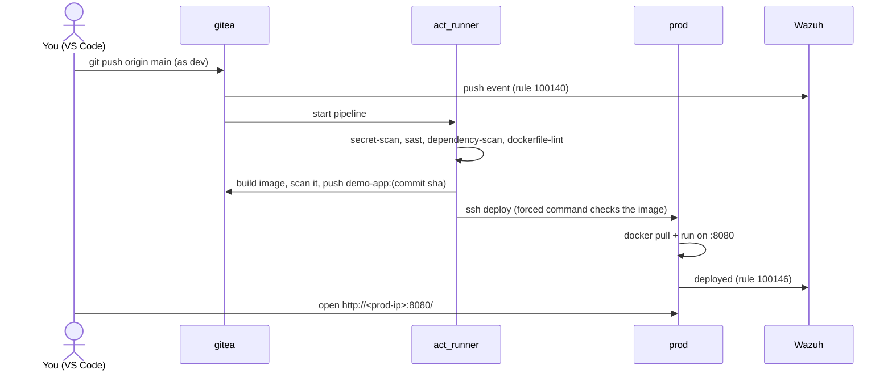

# SOC Lab on Multipass

A blue-team lab built from Multipass + cloud-init on macOS: an Active
Directory domain, a SIEM, a network sensor, config management, and
attacker/target boxes to generate telemetry against -- plus a growing set
of add-on tools (LDAP UI, adversary emulation, DFIR, threat intel, status
dashboards).

## Important constraint: no Windows

Multipass only launches Ubuntu VMs. There is no Windows Server or Windows
10/11 support. The domain controller and everything else here runs on
Linux:

- **Directory service** = **Samba4 as an AD DC** (real AD-compatible LDAP,
  Kerberos KDC, and DNS -- not a simulation, but not Windows Server either).
- **Domain-joined boxes** authenticate against it exactly like a Windows
  estate would (Kerberos, LDAP, group policy concepts largely absent since
  full GPO tooling is a Windows/RSAT thing -- see "Ideas for later" below).

If you later want real Windows Server / Windows clients in the mix, you'll
need a second hypervisor (UTM, Parallels, VMware Fusion) since Multipass
can't provide them; point those VMs' DNS at `dc01`'s IP and they can join
the same `LAB.LOCAL` domain.

## Architecture

| VM              | Role                                                  | Domain-joined |
|-----------------|--------------------------------------------------------|:---:|
| `ansible-ctrl`  | Config management (Ansible control node)              | -   |
| `dc01`          | Samba4 AD DC -- DNS, Kerberos, LDAP for `LAB.LOCAL`; audit logging + Wazuh agent | -   |
| `fs01`          | File server (Samba shares, AD-authenticated)           | Y   |
| `client01..N`   | Domain-joined "workstations" -- count set by `NUM_CLIENTS` | Y |
| `siem`          | Wazuh manager + indexer + dashboard                    | -   |
| `sensor`        | Suricata + Zeek network monitoring + Wazuh agent; the office web proxy (Squid :3128); also the legacy status page, FTP drop and telnet console. In the forensics lab also the lab's gateway and network tap (see [Network forensics lab](#network-forensics-lab)) | -   |
| `redteam`       | Attacker box: nmap, impacket, bloodhound, netexec, hashcat, `lab-kerberoast`, Sliver C2; in the pentest lab also the Kali tool set (see [Pentest lab](#pentest-lab)); in the forensics lab a scheduled attack scenario | -   |
| `vulntarget`    | DVWA + Juice Shop in Docker, for web-attack telemetry  | -   |
| `webtarget2`    | Pentest lab: OWASP WebGoat (+ WebWolf) and OWASP VulnerableApp in Docker | - |
| `lam`           | LDAP Account Manager -- web UI for `dc01`               | -   |
| `caldera`       | MITRE Caldera -- adversary emulation, ATT&CK-mapped     | -   |
| `velociraptor`  | Velociraptor -- DFIR/hunting server; agents on `dc01`, `fs01`, clients | -   |
| `mgmt`          | Semaphore UI (Ansible web UI) + Uptime Kuma (status dashboard) | - |
| `gitea`         | CI/CD: Gitea Git server, Actions runner, container registry | - |
| `prod`          | CI/CD deploy target: runs the container the pipeline ships | - |
| `honeypot`      | Deception: OpenCanary fake FTP/HTTP/SSH/Telnet/MySQL/Redis/VNC | - |
| `mail`          | Company mail for `@lab.local`: Postfix (25/587), Dovecot IMAP (AD logins), Roundcube webmail | - |
| `iris`          | DFIR-IRIS case management; Wazuh alerts of level 10+ arrive as IRIS alerts | - |
| `arkime`        | Forensics lab: Arkime 6.9.1 full packet capture and viewer (`https://<arkime-ip>:8005`) on OpenSearch 3.9.0; tshark, Zeek, ngrep, tcpflow; the case PCAP library in `/srv/pcaps/cases` | - |

Every domain-joined/monitored VM ships logs to `siem` via a Wazuh agent, so
detections can be built and tested end-to-end: attack on `redteam` or
`vulntarget` -> telemetry on `sensor`/endpoint agents -> alert in Wazuh.

### How the servers fit together

All VMs share one flat Multipass NAT network on your Mac. Solid arrows are
normal traffic, dotted arrows are attacks.



The directory on `dc01`, and who can reach what on `fs01`:



How an attack becomes an alert:



The order the deploy script builds things in:



The deploy asks which lab and size to build (`--lab`, `--size`, `--list` shows the totals), so the
footprint is whatever you choose; `--dry-run` prints what would launch. Only one lab can exist at a
time: run `./teardown-soc-lab.sh` before deploying another.

### Pentest lab

`--lab pentest` builds a weak company network to attack, with no SIEM (attacks aren't
detected). It uses off-the-shelf, published training material only: no custom vulnerabilities.

| Size | VMs | Clients |
|---|---|---|
| small | `redteam`, `vulntarget` (DVWA, Juice Shop), `dc01` (the seeded AD accounts, e.g. kerberoastable `svc_sql`) | 1 |
| medium | + `fs01`, `webtarget2` (OWASP WebGoat with WebWolf, OWASP VulnerableApp) | 3 |
| large | + `mail` | 6 |

In this lab `redteam` also gets the Kali tool set on top of its usual tools (all arm64-native):

| Tool | Source |
|---|---|
| Metasploit Framework (`msfconsole`) | Rapid7's apt repo, signing key checked by fingerprint. The repo only has the current nightly build, so it isn't pinned. Starts without a database; run `msfdb init` once for one |
| Burp Suite Community (`burpsuite`) | PortSwigger's 2026.10.1 Linux ARM installer, checked against its published SHA-256. A GUI app: use `ssh -X` or a desktop session |
| sqlmap, hydra, john, gobuster, ffuf, dirb | Ubuntu packages |
| nikto | Ubuntu package (multiverse) |
| SecLists (`/usr/share/seclists`) | GitHub tag `2026.2`, SHA-256 checked |
| Responder (`sudo responder`) | GitHub tag `v3.2.2.0`, SHA-256 checked |
| enum4linux-ng | GitHub tag `v1.3.10`, SHA-256 checked |

arm64 gaps: none of these tools had to be skipped. The only compromise is Metasploit, which has no
pinnable arm64 release, only Rapid7's nightly apt build. `lab-info.sh` lists the web apps' URLs.

### Network forensics lab

`--lab forensics` is for finding attacks and data theft in packet captures and network logs: live
traffic from the lab plus a library of public case PCAPs, analysed in Arkime, Zeek and tshark.

| Size | VMs | Clients |
|---|---|---|
| small | `sensor`, `arkime`, `dc01`, `redteam`, `vulntarget` | 1 |
| medium | + `fs01`, `mail`, `honeypot` | 3 |
| large | + `siem` (correlate Wazuh alerts with the packets) | 6 |

**A real network tap.** Multipass gives each VM only its own traffic, so in this lab `sensor` is the
lab's gateway. Once every VM is up, the deploy (stage 4b) gives each other VM (all but `sensor` and
`arkime`) a persistent netplan drop-in, `/etc/netplan/60-lab-gateway.yaml`: its default route and its
routes to the other lab VMs go through `sensor`. `sensor` forwards that traffic (and NATs what leaves
the lab), never sends ICMP redirects, and copies every packet it forwards to `arkime` with iptables'
`TEE` target (`lab-gateway.service`, which reads arkime's IP from `/etc/lab-gateway.conf`). So
Arkime, and Zeek and Suricata on `sensor`, see east-west traffic too: clients' SMB to `fs01`,
Kerberos and LDAP to `dc01`, mail, and the attacks. The stage checks every VM still resolves
through `dc01` and reaches the Ubuntu mirror. It can't be done at boot: `dc01` and the other early
VMs launch before `sensor` exists.

**Arkime** (`https://<arkime-ip>:8005`, self-signed certificate, `admin` / the lab `ADMIN_PASS`):
Arkime's arm64 package for Ubuntu 24.04 (SHA-256 checked) on a single-node OpenSearch that listens
on `127.0.0.1` only. The analyst tools are on the same VM: `tshark`, `zeek` (the `zeek/zeek:lts`
image behind a wrapper: `zeek -C -r case.pcap`), `ngrep`, `tcpflow`, `tcpdump`.

**Case PCAPs.** `seed/case-pcaps.txt` pins public exercise PCAPs (malware-traffic-analysis.net
training exercises: URL, SHA-256, zip password). `arkime` downloads them while it provisions,
straight to `/srv/pcaps/cases` (never to the Mac), checks each with `sha256sum` and deletes and logs
(`/var/log/case-pcaps.log`) any that don't match. They stay in their password-protected zips; the
passwords are in `/srv/pcaps/cases/INDEX.txt`. They hold real malware traffic: open them on `arkime`
only. To look at one in Arkime: `unzip` it, then `sudo /opt/arkime/bin/capture -r <file.pcap> -t case`.

**The attack scenario.** `redteam` runs `lab-attack.timer` every 30 minutes (first run 30 minutes
after boot; start one now with `sudo systemctl start lab-attack`). It only chains tools the lab
already has, with the seeded accounts:

1. a SYN scan (`nmap --top-ports 100`) of the lab's VMs,
2. a Kerberoast of `svc_sql` with `lab-kerberoast` as `alice.user`,
3. an SMB grab of `\\fs01\finance` with `smbclient` as `jane.finance`,
4. curl requests at DVWA and Juice Shop (SQL injection, XSS, file inclusion, admin pages),
5. DNS-tunnel-style exfil: the grabbed data, hex-encoded in up to 200 lookups of
   `<hex>.<n>.<session>.x.lab.local` against `dc01` (answered NXDOMAIN, so nothing leaves the lab).

What it did is in `/var/log/lab-attack.log` on `redteam`; the deploy writes its targets to
`/etc/lab-attack/config`. Neither the gateway nor the scenario exists in the other labs.

### Screenshots

| Wazuh dashboard (`siem`) | MITRE Caldera | Velociraptor |
|---|---|---|
|  |  |  |

### Adding more clients

The number of clients comes from the size you choose (1, 3 or 6; see `LAB_CLIENTS` in
`lib/labs.sh`). The script renders `client.yaml.tmpl`
once per client with a zero-padded hostname (`client01`, `client02`, ...),
launches them one after another (they provision in parallel), and adds each to the generated Ansible
inventory under `[clients]`. `CLIENT_SPEC` in `lib/labs.sh` controls the CPU/RAM/disk applied to every
client uniformly.

## Usage

```bash
# 1. review/edit domain name + admin password in deploy-soc-lab.sh
# 2. requires bash 4+ (macOS default bash is 3.2)
brew install bash jq   # jq: the deploy script and lab-info.sh need it
# Multipass: the 1.16.4 .pkg from https://github.com/canonical/multipass/releases
/opt/homebrew/bin/bash ./deploy-soc-lab.sh
```

The script launches VMs in dependency order (ansible-ctrl -> siem -> dc01 ->
everything else, launched one at a time but provisioning in parallel), polls
`cloud-init status` at each dependency point, installs the lab's Wazuh
detection rules on `siem` and the Velociraptor agent on `dc01`, `fs01` and the
clients, wires up the CI/CD pipeline, fills the lab with test data and starts
the simulated staff (see "Test data and simulated activity"), pushes a
generated Ansible inventory to `ansible-ctrl`, and finally prints an overview
of the lab:

- every VM with its role and IP,
- every domain account and its password, including the generated staff,
- the FTP and telnet accounts on `sensor`,
- every web app with its URL, login and whether it answers right now.

While it runs, the deploy shows a live status panel: a total progress bar
with the elapsed time, the current stage, one bar per VM with its current
provisioning step ("4/6 Creating OUs, groups and users"), and one for the
deploy's own tasks (Wazuh rules, Velociraptor agents, CI/CD wiring, each
test-data role, the inventory). Every step counts the same toward the total,
and a VM that failed counts as finished. Messages scroll above the panel.

```text
SOC-lab deploy  [████████████████████░░░░░░░░░░]  69%  31m04s
Stage 4/8: clients, file server, sensor, red team, vuln target, and add-on tools

  ansible-ctrl  [████████████] done
  siem          [████████████] done
  dc01          [████████████] done
  fs01          [████████████] done
  client01      [█████████░░░] 4/5 Registering in AD DNS
  caldera       [████░░░░░░░░] 2/6 Installing Node.js
  mgmt          [░░░░░░░░░░░░] launching... Retrieving image: 64%
  gitea         [░░░░░░░░░░░░] queued
  deploy tasks  [█░░░░░░░░░░░] 1/19 waiting
```

When the output isn't a terminal (`... | tee deploy.log`, CI), or with
`NO_PROGRESS=1`, it prints one timestamped line per change instead. The VMs
report their step through `/run/lab-progress`, written by `lab_step` calls in
each template's `provision.sh` (see `lib/progress.sh`).

Check the lab's health any time (VMs, disk, failed services, Wazuh agents,
Velociraptor clients, the activity services, DNS still pointing at `dc01`).
It changes nothing, prints a hint for every problem and exits 1 if anything
failed:

```bash
/opt/homebrew/bin/bash ./lab-doctor.sh
```

Re-print that overview any time (IPs can change after a host reboot) with:

```bash
/opt/homebrew/bin/bash ./lab-info.sh
```

Each VM gets `READY_TIMEOUT` (45 minutes by default) to finish
provisioning. If a VM fails to launch or provision, the others still finish,
then the script prints which ones failed and exits non-zero without writing
the inventory. Fix the cause, delete the broken VMs with `multipass delete
--purge <name>`, and re-run it: VMs that already exist are skipped. The
domain password `ADMIN_PASS` must not contain `"`, `$`, `` ` ``, `\` or a
newline; the script refuses to start otherwise.

Tested with Multipass 1.16.4 (QEMU driver) on macOS 27. The script never runs
two `multipass` commands at once: VMs are launched one after another (each
launch returns after `STAGE4_LAUNCH_TIMEOUT` while the VM keeps provisioning,
and the panel checks the VMs one at a time), because the Multipass daemon crashes under concurrent launches
-- see "Known rough edges".

To tear the whole lab down:

```bash
./teardown-soc-lab.sh
```

Teardown deletes and purges only the lab's own VMs; other Multipass
instances on your Mac are untouched. The rendered cloud-init files in
`.rendered-cloud-init/` contain the lab passwords: they are gitignored and
left on disk for inspection, so delete the folder when you no longer need it.

## Default lab accounts (change the password in the script before real use)

| Account | Notes |
|---|---|
| `Administrator` | Domain Admin, password set by `ADMIN_PASS` in the script |
| `alice.user`, `bob.user` | Plain domain users |
| `jane.finance` | Member of `Finance`, can reach the `finance` share on `fs01` |
| `mike.helpdesk` | Member of `HelpDesk` and `IT-Admins` |
| `svc_sql` | Service account with an SPN (`MSSQLSvc/fs01...`) that only supports RC4 -- **intentionally kerberoastable** |
| `svc_legacy` | Service account with "Do not require Kerberos pre-authentication" -- **intentionally AS-REP roastable** |

All seeded passwords are `Passw0rd!23` except `svc_sql` (`SqlServ1ce#2024`)
and `svc_legacy` (`Backup2024!`). They are set at the top of
`deploy-soc-lab.sh` (`SEED_PASS`, `SVC_SQL_PASS`, `SVC_LEGACY_PASS`).
Domain passwords never expire (`dc01` sets the maximum password age to 0),
so a lab left running for weeks still accepts them; complexity rules stay on.

On top of these, the deploy creates ~46 generated staff with their own
random passwords (some deliberately weak). `lab-info.sh` lists them all;
see "Test data and simulated activity".

## Test data and simulated activity

An empty lab makes a poor SOC: there is nothing to hunt through and every
alert is the attack. So after building the VMs, the deploy script (stage 7)
runs [`seed/labdata.py`](seed/labdata.py) on them. It fills the lab with a
fictional company, **Kestrel Nordic AB**, and starts staff and servers that
keep working in the background. Everything is random per lab: names,
passwords, documents, amounts. All dates are relative to the day you deploy,
so file times, invoice dates, payroll months and git history always look
current. It uses Python's standard library only, with no downloads.

The roster is generated once, kept in `.rendered-cloud-init/lab-roster.json`
(gitignored), and printed by `lab-info.sh`. Re-running the deploy adds
nothing twice; `teardown-soc-lab.sh` deletes the roster, so the next lab
gets new people.

| VM | Data it gets |
|---|---|
| `dc01` | ~46 staff in an OU per department, with title, phone, office, email, employee ID and manager. Groups per department plus `All-Staff`, `VPN-Users`, `Finance`, `HelpDesk`, `IT-Admins`. ~24 computer accounts with operating systems, including an old `SRV-BACKUP01`. Written locally, so seeding raises no audit alerts. |
| `fs01` | ~120 files with past timestamps and real owners: phone list, org chart, handbook, policies (`.docx`), newsletters, change requests, a sales pipeline, proposals, project meeting notes. On `finance`: invoices by month, budgets, three months of payroll, a vendor list. |
| `client01..N` | Home folders for the 3 people who use each workstation (documents, downloads, `.bash_history`), and the **staff activity** service below. |
| `gitea` | Gitea accounts for Engineering and IT staff, an `engineering` org with 4 repos, months of backdated commits by several authors, and issues with comments. |
| `sensor` | The office's legacy services: an IT status page with downloads (port 80), a scan-to-FTP drop (vsftpd) and a telnet console. |
| `mgmt` | A Semaphore project, "Lab operations", with an inventory of the lab, an SSH key and the playbooks from `infra-ansible`. It runs those jobs on a schedule. Uptime Kuma gets an admin account and ~17 monitors (web apps, LDAP, Kerberos, SMB, DNS, FTP, SSH) that check the lab every minute. |
| `lam` | A server profile for the domain over LDAPS (verified against `dc01`'s Samba CA), so Administrator and every IT staff member can log in with their domain password. |
| `velociraptor` | An API user (`lab-analyst`) and four baseline hunts across the agents: endpoint inventory, local accounts, SSH authorized keys, cron jobs. |
| `ansible-ctrl` | Day-to-day playbooks in `~/soc-lab-ansible/playbooks`, run on a schedule. |
| `vulntarget` | DVWA's database, created for you. |
| `mail` | A mailbox for every member of staff (leavers too), group addresses (`it@`, `helpdesk@`, `finance@`, `hr@`, `sales@`, `info@`, `all-staff@`) and a few weeks of old mail in each: colleagues, all-staff notices, newsletters, vendor invoices with PDFs, customer questions. Dovecot checks passwords against AD over LDAPS. |

`siem` and `prod` get their data from the activity rather than from
seeding. `redteam`, `caldera` and `honeypot` stay empty on purpose:
an attacker starts blind, and a honeypot that legitimate traffic touches is
useless.

**Mistakes left in the data for you to find:**
- A backup script on the `public` share with `svc_legacy`'s password.
- `svc_sql`'s password in the history of `billing-api` ("removed" one commit later).
- The same password in an IT admin's `.bash_history`.
- New hires still on `Welcome<year>!`, and a few people on `<Season><year>!`.
- Leavers who are disabled but still in `VPN-Users`.
- A shared FTP account.
- Telnet logins in cleartext.
- Payroll exports with bank account numbers.

### Activity that never stops

These run as systemd services with `Restart=always`. Each one loops: one
burst of work, then a random pause.



What each person does depends on their department:
- **Everyone** logs on with Kerberos (5% mistype first), opens files on the
  shares, saves notes, looks up names in DNS, reads the status page and the
  intranet, downloads files, uses the FTP drop and shops on Juice Shop.
  Everyone reads their mail (IMAP, or Roundcube now and then; a mistyped
  password is a failed LDAP bind on `dc01`), writes to colleagues through
  submission (587, cleartext AUTH like many old office setups) and clears
  out newsletters. All web traffic goes through the proxy on `sensor`.
- **Finance** opens invoices and payroll on `\\fs01\finance`. Others
  occasionally try it and get *access denied*.
- **Engineering** clones, pulls and pushes the `engineering` repos and tests
  DVWA pages. Now and then they push to `demo-app`, which runs the whole
  pipeline and deploys to `prod`.
- **IT** SSHes to servers for admin commands, uses the telnet console and
  opens the admin consoles. They log in for real to Uptime Kuma (shared
  admin account), LDAP Account Manager (their own domain account: an LDAP
  bind on `dc01`) and Caldera (as `blue`, read-only: agents and operations,
  never starting one), and mistype the password now and then.
- **Mail from outside** (`lab-mailflow` on `mail`): newsletters, vendor
  invoices to `finance@`, customer questions to `sales@`, parcel notices,
  arriving over SMTP every few minutes in office hours. Nothing malicious:
  phishing is yours to send (see the scenarios).
- **The SOC analyst** on `velociraptor` starts a hunt every one to four
  hours in office hours, picked from a dozen built-in Linux artifacts
  (processes, network connections, SSH logins, shell history, SUID files...).

Where it shows up:
- **Wazuh**: Kerberos and SMB events from `dc01`, including the typos as
  rule 100104. SSH logins and sudo on every server. Telnet and FTP logins on
  `sensor`. Git pushes. Pipeline and deploy events.
- **Zeek and Suricata** on `sensor`: HTTP, FTP and telnet sessions, and all
  the staff's web traffic, because it goes through the proxy there.
- **Squid's access log** (`/var/log/squid/access.log` on `sensor`, rule 100190
  in Wazuh): every page and download per client, HTTPS as `CONNECT host:port`.
- **Velociraptor**: the analyst's hunts and their results, plus processes,
  files and logons you collect yourself.
- **Every app's own logs**, most of them also in Wazuh: Gitea, Semaphore's
  task results (rules 100180/100181), the Juice Shop accounts staff
  register, Uptime Kuma's logins and outages (100160-100163, from
  `/var/log/lab-apps/` on `mgmt`), LAM's logins (100170-100173; a failed one
  is also rule 100110 on `dc01`), Postfix, Dovecot and Roundcube on `mail`.
  Caldera doesn't log logins at its default log level.
- **The Wazuh dashboard "SOC-lab overview"** (Dashboards menu) puts it
  together: attack alerts, failed logins by VM, honeypot touches, proxy
  clients and URLs, web-app logins, CI/CD and mail events, plus saved
  searches "SOC-lab: attacks (level 10+)", "failed logins", "proxy log" and
  "mail" to start an investigation from.
- **DFIR-IRIS** (`iris`): every alert of level 10 or higher arrives as an
  IRIS alert (severity from the rule level), ready to triage into a case.
  The simulated staff never trigger these.

Every action is also written to a ground-truth log on the VM that did it:
- `/var/log/lab-activity.log` on each client,
- `/var/log/lab/ansible.log` on `ansible-ctrl`,
- `/var/log/lab-semaphore.log` on `mgmt`,
- `/var/log/lab-backup.log` on `fs01`,
- `/var/log/lab-velociraptor.log` on `velociraptor`,
- `/var/log/lab-mailflow.log` on `mail`.

None of this traffic is an attack, so it doesn't trigger the lab's attack
rules. You add the attacks yourself (see the scenarios below) and practise
finding them in the noise.

To pause it: `sudo systemctl stop lab-activity` on a client (likewise
`lab-ansible` on `ansible-ctrl`, `lab-semaphore` on `mgmt` and
`lab-velociraptor` on `velociraptor`, `lab-mailflow` on `mail`). To switch it
off for good, use `systemctl disable --now`.

## Add-on tool access

| Tool | URL / how to reach it | Credentials |
|---|---|---|
| Wazuh dashboard | `https://<siem-ip>/` | `admin` / generated at install -- `lab-info.sh` prints it |
| DVWA | `http://<vulntarget-ip>/` | `admin` / `password` (the deploy creates the database), then set the difficulty |
| Juice Shop | `http://<vulntarget-ip>:3000/` | no login needed to start |
| OWASP WebGoat | `http://<webtarget2-ip>:8080/WebGoat/` (WebWolf: `:9090/WebWolf/`) | register your own account |
| OWASP VulnerableApp | `http://<webtarget2-ip>:9091/VulnerableApp/` | no login |
| LDAP Account Manager | `http://<lam-ip>/lam` | `Administrator` / the lab `ADMIN_PASS`, or any IT staff account from `lab-info.sh`; LAM's own config password is `lam` |
| MITRE Caldera | `http://<caldera-ip>:8888` | `red` / `admin` (also `blue` / `admin`, `admin` / `admin`): Caldera's `--insecure` defaults |
| Velociraptor | `https://<velociraptor-ip>:8889` (self-signed certificate) | `admin` / the lab `ADMIN_PASS` |
| Uptime Kuma | `http://<mgmt-ip>:3001` | `admin` / generated at deploy -- `lab-info.sh` prints it |
| Webmail (Roundcube) | `http://<mail-ip>/roundcube/` | any staff account (`sAMAccountName` + AD password); IMAP 143 and SMTP 25/587 on the same VM |
| DFIR-IRIS | `https://<iris-ip>/` (self-signed certificate) | `administrator` / the lab `ADMIN_PASS`; Wazuh alerts of level 10+ show up under Alerts |
| Semaphore UI | `http://<mgmt-ip>:3000` | `admin` / the lab `ADMIN_PASS`; project "Lab operations" is ready to run |
| Arkime (forensics lab) | `https://<arkime-ip>:8005/` (self-signed certificate) | `admin` / the lab `ADMIN_PASS` |
| IT status page | `http://<sensor-ip>/` | no login; FTP (`ftp <sensor-ip>`) and telnet (`telnet <sensor-ip>`) accounts are in `lab-info.sh` |

**LDAP Account Manager** is set up by the deploy's test-data stage: a
server profile from LAM's Samba 4 template, `ldaps://dc01.lab.local:636`
(Samba refuses password binds over plain LDAP), with `dc01`'s Samba CA
trusted in `/etc/ldap/ldap.conf`. If you already changed the profile
yourself, the deploy leaves it alone.

## CI/CD pipeline

`gitea` hosts the repository `labadmin/demo-app` (a small Flask app) and its
pipeline (`.gitea/workflows/pipeline.yml`). The deploy script pushes it as the
developer account `dev`, and the first run deploys the app to `prod`. Every
push to `main` runs:

| Job | Tool | Stops the deploy when |
|---|---|---|
| `secret-scan` | gitleaks (whole git history) | a credential is committed |
| `sast` | Semgrep (`p/python`, `p/dockerfile`) | the code or Dockerfile has a finding |
| `dependency-scan` | Trivy (filesystem) | a dependency has a fixable HIGH/CRITICAL CVE |
| `dockerfile-lint` | hadolint | the Dockerfile has an error-level issue |
| `build` | docker build + Trivy (image) | the image has a fixable CRITICAL CVE |
| `deploy` | SSH to `prod` | -- (runs only if everything above passed) |



The pipeline's deploy key on `prod` is bound to a forced command
(`/usr/local/bin/lab-deploy`) that only accepts
`<gitea-ip>:3000/labadmin/demo-app:<build sha>` images from the lab registry,
and logs every attempt. Logins: `lab-info.sh` (Gitea `labadmin` = the lab
`ADMIN_PASS`, `dev` = the seeded user password).

Exercises (each raises a Wazuh alert, see below):

- **Leak a secret**: as `dev`, commit a file with an access-key-looking
  string and push -- `secret-scan` fails and nothing deploys (rule 100143).
- **Rewrite history** to hide it: `git reset --hard HEAD~1 && git push --force`
  (rule 100142).
- **Poison the pipeline**: edit `.gitea/workflows/pipeline.yml`, e.g. delete a
  gate, and push (rule 100141).
- **Bypass the pipeline**: on `prod`, `sudo docker run -d nginx:alpine`
  (rule 100147); or use the deploy key to ship a foreign image -- the forced
  command rejects it (rule 100145).

### From VS Code to production, step by step

This walks one change from your Mac through the pipeline to `prod`. Run
`/opt/homebrew/bin/bash ./lab-info.sh` first: it prints the Gitea and `prod`
addresses used below as `<gitea-ip>` and `<prod-ip>`. The Mac can reach the
VMs directly on the Multipass network.



1. **Install the tools**: [VS Code](https://code.visualstudio.com/) and Git
   (`xcode-select --install` or `brew install git`). Optionally install VS
   Code's Python extension.
2. **Clone the repository**. In VS Code, press `Cmd+Shift+P`, run
   **Git: Clone** and paste `http://<gitea-ip>:3000/labadmin/demo-app.git`.
   Pick a folder and choose **Open** when VS Code asks. When Git asks for
   credentials, use `dev` and the seeded password (`Passw0rd!23` unless you
   changed `SEED_PASS`). macOS keeps them in the Keychain: they are lab-only
   credentials, but you can remove them later in Keychain Access (search for
   the Gitea IP).
3. **Set who you are** for this repository. In VS Code's terminal
   (`` Ctrl+` ``):
   ```sh
   git config user.name "Your Name"
   git config user.email "you@lab.local"
   ```
4. **Make a change**. Open `app.py` and add a route under the existing ones:
   ```python
   @app.get("/hello")
   def hello():
       return jsonify(message="Hello from my first pipeline run")
   ```
5. **Optionally, run it locally** before you push:
   ```sh
   python3 -m venv .venv && source .venv/bin/activate
   pip install -r requirements.txt
   flask --app app run          # http://127.0.0.1:5000/hello
   ```
   `.venv` must not end up in the repository: add it to a `.gitignore` file.
6. **Commit**. Open Source Control (`Ctrl+Shift+G`), check that only
   `app.py` (and `.gitignore`) are listed, type a message such as
   "Add /hello" and click **Commit**.
7. **Push**. Click **Sync Changes**, or run `git push origin main`. The
   pipeline only runs for pushes to `main`.
8. **Watch the pipeline** at
   `http://<gitea-ip>:3000/labadmin/demo-app/actions` (log in as `dev`). The
   four gates run first, in parallel. `build` starts only when all of them
   passed, and `deploy` only after `build`. Click a job to see its log. A
   full run takes a few minutes; the first one is the slowest because it
   pulls the scanner images.
9. **Check production**:
   ```sh
   curl http://<prod-ip>:8080/hello
   curl http://<prod-ip>:8080/health   # "build" is your commit's first 12 characters
   git rev-parse --short=12 HEAD       # ...which this prints
   ```
10. **Find your change in the SIEM**. In the Wazuh dashboard, open
    **Threat Hunting** and filter on `rule.id: (100140 OR 100144 OR 100146)`:
    you'll see your push, the image build and the deploy.
11. **See a gate stop a deploy** (optional). Add a line like
    `AWS_SECRET_ACCESS_KEY = "<40 random letters and digits>"` to `app.py`,
    commit and push. `secret-scan` fails, `build` and `deploy` are skipped,
    and Wazuh shows rule 100143. Undo it with `git revert HEAD` and push
    again. The secret stays in the history, so gitleaks keeps failing
    until you rewrite it, which is the force-push exercise above.

The simulated developers push to `demo-app` too (see "Activity that never
stops"), so you'll sometimes see runs you didn't start. Pull before you
push (`git pull --rebase`).

## Detections

Custom Wazuh decoders and rules live in [`wazuh/`](wazuh/) and are installed
on `siem` by the deploy script. The attack rules were tested end to end by
running the attack from `redteam`; the web-app rules (1001[678]x) with real
logins from the clients plus `wazuh-logtest` for the bursts.

| Rule | Level | Detects | Source |
|---|---|---|---|
| 100101 | 10 | Kerberoasting: RC4 service ticket for a non-krbtgt service (T1558.003) | `dc01` KDC log |
| 100102 | 12 | Kerberoasting burst: 3+ RC4 service tickets for one user in 5 min | `dc01` KDC log |
| 100103 | 10 | AS-REP roasting: TGT issued without pre-authentication (T1558.004) | `dc01` KDC log |
| 100104 | 3 | Wrong password at a Kerberos logon (pre-authentication failed) | `dc01` KDC log |
| 100105 | 10 | Kerberos password spraying: 5+ accounts fail pre-authentication from one address in 2 min (T1110.003) | `dc01` KDC log |
| 100110 | 3 | Failed logon on the DC (SMB, LDAP, Kerberos, ...) | `dc01` auth audit |
| 100111 | 10 | Password spraying: 5+ different accounts fail from one IP in 2 min (T1110.003) | `dc01` auth audit |
| 100112 | 10 | Brute force: 8+ failures for one account in 2 min (T1110.001) | `dc01` auth audit |
| 100120 | 12 | Account added to Domain/Enterprise/Schema Admins or Administrators (T1098) | `dc01` group audit |
| 100121 | 5 | Any AD group membership change | `dc01` group audit |
| 100122 | 8 | New AD user/object created (T1136.002) | `dc01` directory audit |
| 100123 | 8 | Password reset by another account (T1098) | `dc01` password audit |
| 100131 | 8 | Network scan signature from Suricata (T1046) | `sensor` Suricata |
| 100132 | 10 | Port scan: 4+ scan signatures from one source in 2 min (T1046) | `sensor` Suricata |
| 100140 | 3 | Git push (repo, ref, pusher) | `gitea` hook |
| 100141 | 10 | CI/CD pipeline definition changed (T1195.002) | `gitea` hook |
| 100142 | 10 | Force push rewrote history (T1195.002) | `gitea` hook |
| 100143 | 5 | A pipeline gate or the deploy failed | `gitea` pipeline events |
| 100144 | 3 | Image pushed / deployed by the pipeline | `gitea` pipeline events |
| 100145 | 12 | `prod` rejected a deploy of an unapproved image (T1610) | `prod` deploy log |
| 100146 | 3 | `prod` deployed an image | `prod` deploy log |
| 100147 | 12 | Container started on `prod` from outside the lab registry (T1610) | `prod` docker events |
| 100150 | 10 | Anything touched the honeypot (T1046) | `honeypot` OpenCanary |
| 100151 | 12 | Login attempt against a honeypot service (T1110) | `honeypot` OpenCanary |
| 100160 | 3 | Uptime Kuma login | `mgmt` Kuma log |
| 100161 | 5 | Uptime Kuma failed login | `mgmt` Kuma log |
| 100162 | 10 | Uptime Kuma brute force: 6+ failed logins from one address in 2 min (T1110.001) | `mgmt` Kuma log |
| 100163 | 7 | An Uptime Kuma monitor went down (service outage) | `mgmt` Kuma log |
| 100170 | 3 | LDAP Account Manager login | `lam` syslog |
| 100171 | 5 | LDAP Account Manager failed login | `lam` syslog |
| 100172 | 10 | LAM brute force: 6+ failed logins from one address in 2 min (T1110.001) | `lam` syslog |
| 100173 | 10 | LAM login by an account that isn't Administrator or in `OU=IT` (T1078.002) | `lam` syslog |
| 100180 | 3 | Semaphore task started | `mgmt` Semaphore log |
| 100181 | 5 | Semaphore task failed | `mgmt` Semaphore log |

Wazuh's built-in rules cover the rest of the endpoint telemetry (SSH
invalid users, sudo, PAM, file integrity, Suricata alerts at level 3).

## Example detection/hunting scenarios to build against

- **Kerberoasting**: from `redteam`, get `svc_sql`'s service ticket and crack
  it offline:
  `lab-kerberoast alice.user 'Passw0rd!23' MSSQLSvc/fs01.lab.local:1433 svc_sql > tgs.hash`
  then `hashcat -m 13100 tgs.hash <wordlist>`. (`lab-kerberoast` wraps MIT
  `kinit`/`kvno`: Samba 4.19 rejects impacket's TGS request, so
  `impacket-GetUserSPNs -request` and `nxc --kerberoasting` fail here --
  listing SPNs with `impacket-GetUserSPNs` still works.) Wazuh: rule 100101.
- **AS-REP roasting**: `impacket-GetNPUsers lab.local/svc_legacy -dc-ip
  <dc01-ip> -no-pass -format hashcat > asrep.hash`, then
  `hashcat -m 18200 asrep.hash <wordlist>`. Wazuh: rule 100103.
- **Password spraying / brute force**: build `users.txt` from AD
  (`ldapsearch` or `nxc ldap ... --users` as alice.user), then try one
  password against all of them, e.g. `<Season><year>!` or `Welcome<year>!`:
  `nxc smb <dc01-ip> -u users.txt -p 'Autumn2026!' --continue-on-success`
  (or `kinit` in a loop for Kerberos spraying). Wazuh: rules 100110-100112
  for SMB/NTLM, 100104/100105 for Kerberos.
  SSH password logins are disabled on the Ubuntu cloud images, so `hydra`
  against SSH only produces invalid-user alerts.
- **Persistence in AD**: as Administrator over LDAP, create an account,
  add it to Domain Admins or reset someone's password
  (`samba-tool ... -H ldap://dc01.lab.local -U administrator`). Wazuh: rules
  100120-100123. (Changes made with `samba-tool` locally on `dc01` without
  `-H` bypass the server and its audit log.)
- **Network scanning**: `sudo nmap -sS -O <sensor-ip>` from `redteam`.
  Suricata's Emerging Threats scan signatures fire on `sensor`; Wazuh:
  rules 100131/100132.
- **Web attack telemetry**: DVWA and Juice Shop on `vulntarget` (SQLi, XSS,
  command injection, broken auth/access control) for triage/detection-rule
  practice.
- **AD recon**: `bloodhound-python` / `ldapsearch` from `redteam` against
  `dc01` to map attack paths, then discuss what LDAP-recon detections would
  look like in a real environment.
- **ATT&CK-mapped adversary emulation**: run a Caldera operation against a
  client/fs01 and use the known-ground-truth technique list to check
  whether your Wazuh rules actually catch it.
- **Network-metadata hunting**: pivot from a Suricata alert on `sensor` into
  Zeek's `conn.log`/`dns.log`/`http.log` for the same traffic -- practice
  the "alert says X, what does the connection metadata actually show"
  workflow.
- **Credential hunting**: as any domain user, search `\\fs01\public`
  (`smbclient //fs01.lab.local/public -U alice.user -c 'recurse; ls'`), the
  `engineering` repos' git history (`git log -p`, or run gitleaks against a
  clone) and, as root on a client, home folders. Several passwords are lying
  around (see "Mistakes left in the data").
- **Find the attacker in the noise**: the simulated staff produce a steady
  stream of logons, file access, SSH and web traffic. Run an attack, then
  find it in Wazuh, Zeek and Velociraptor among the normal activity, and use
  the ground-truth logs (`/var/log/lab-activity.log`) to check your work.
- **Cleartext protocols**: watch Zeek's `ftp.log` and the telnet sessions on
  `sensor`, and pull the FTP password out of the traffic.
- **Deception**: scan or log in to `honeypot` from `redteam` (`nmap
  <honeypot-ip>`, `ftp <honeypot-ip>`, `ssh -p 2222 <honeypot-ip>`, or the
  fake NAS login page on port 80) -- every touch is an alert (100150/100151).
- **Command and control**: `sudo sliver-server` on `redteam` starts the Sliver
  C2 console; generate an implant, run it on a client, and hunt for the
  beacon with Zeek/Suricata and Velociraptor.
- **Endpoint DFIR**: `dc01`, `fs01` and the clients run the Velociraptor
  agent; run a hunt across them from the Velociraptor GUI after simulating
  compromise.
- **Phishing investigation**: send a lure yourself from `redteam` to a member
  of staff, e.g. `swaks --to <user>@lab.local --from it-support@lab-help.example
  --server <mail-ip> --header "Subject: Password expiry" --body "..."` (`sudo
  apt install swaks`). Then trace it as the analyst: Postfix's log on `mail`
  (who sent it, from which address), the message in the user's mailbox
  (Roundcube or `/var/vmail/lab.local/<user>/`), and the proxy log for anyone
  opening the link. Nothing in the simulation sends phishing, so whatever you
  find is yours.
- **Spraying through the mail server**: IMAP and SMTP logins are checked
  against AD, so a spray against `mail` shows up on `dc01` (rules 100110/
  100111) with `mail`'s address as the source -- correlate with Dovecot's own
  log on `mail` to find the real attacker.
- **Case work in IRIS**: every attack alert (level 10+) lands in DFIR-IRIS.
  Triage it, merge related alerts into a case, add the IOCs and assets you
  found in Wazuh, Zeek and Velociraptor, and write the timeline.
- **Config drift / hardening checks**: use the Ansible control node (or
  Semaphore's web UI on `mgmt`) to run CIS-style checks across
  `fs01`/`client01..N` and remediate drift.

## Known rough edges (read before you file a bug against yourself)

- **IP-bound pieces (mail, lam, IRIS)**: `mail` and `lam` reach `dc01` over
  LDAPS through an `/etc/hosts` entry with `dc01`'s deploy-time IP, and IRIS'
  certificate is made for `iris`' own IP (that is what the Wazuh integration
  verifies). If DHCP hands out new addresses after a host reboot,
  `lab-doctor.sh` shows it; update the hosts entries, or delete `iris` and
  re-run the deploy for a new certificate and hook URL.
- **Cleartext mail logins, on purpose**: Dovecot and Postfix submission accept
  passwords without TLS, like many old office setups. The staff's AD
  passwords cross the network in the clear -- a finding to make, not a bug.
- **Multipass daemon bugs** (found while testing this lab on macOS 27, and
  reported upstream):
  - The daemon corrupts its heap and crashes (macOS's allocator aborts it:
    `SIGTRAP`/`SIGSEGV`/`SIGABRT` in malloc, libssh or gRPC) when several VMs
    launch at once -- seen on both 1.16.4 and 1.17.0, with as few as two
    parallel launches. Don't run `multipass` commands in parallel; the deploy
    script doesn't. ([#5476](https://github.com/canonical/multipass/issues/5476#issuecomment-6615330811))
  - `multipass exec` hangs forever when the command's output is redirected to
    `/dev/null` on the Mac (pipes and files work) -- 1.16.4 and 1.17.0. The
    deploy script never does this. ([#5498](https://github.com/canonical/multipass/issues/5498))
  - After a daemon crash, the restarted daemon can hang at 100% CPU because
    the old VMs' QEMU processes still hold their disk locks; the CLI and GUI
    then show "waiting for daemon". Recover with `sudo kill -9 <qemu pids>`
    and `sudo launchctl kickstart -k system/com.canonical.multipassd`.
    ([#5499](https://github.com/canonical/multipass/issues/5499))
  - Multipass 1.17.0's own failures (launch timeout, unknown instance) exit
    with 2, not the 255 its release notes describe.
    ([#5500](https://github.com/canonical/multipass/issues/5500))
  - A `multipass launch --timeout` that expires before the VM has booted
    leaves it permanently in "Unknown" state; the deploy script's
    `STAGE4_LAUNCH_TIMEOUT` is sized to avoid this, and it deletes and
    relaunches a stuck VM once.
    ([#5501](https://github.com/canonical/multipass/issues/5501))

- **fs01 AD idmap**: `security = ads` + winbind idmap is one of the more
  finicky corners of Samba. Provisioning waits (up to 2 minutes) for winbind
  to resolve `LAB\Finance` before setting the group on `/srv/shares/finance`,
  and fails cloud-init with `wbinfo` diagnostics in `/var/log/provision.log`
  if it never does. To debug, run `wbinfo -t` and `wbinfo -g` on `fs01`.
- **sensor visibility**: Multipass VMs sit behind NAT with no shared bridge,
  so both Suricata and Zeek on `sensor` only see their own traffic, not a
  real span port. Treat it as host-based monitoring, not full network
  visibility: scan or attack `sensor` itself to see network detections.
  The exception is web traffic that goes through the Squid proxy on
  `sensor` (the simulated staff's browsing): that passes through it, so
  Zeek and Suricata see it. An attacker who doesn't use the proxy stays
  invisible to them. The forensics lab is the exception: there every VM
  routes through `sensor` (see [Network forensics lab](#network-forensics-lab)).
- **Forensics routes are IP-bound**: the netplan drop-ins hold `sensor`'s
  and the other VMs' deploy-time IPs, and `/etc/lab-gateway.conf` on
  `sensor` holds `arkime`'s. If DHCP hands out new addresses after a host
  reboot, `lab-doctor.sh` flags it; fix those files (then `sudo netplan
  apply` / `sudo systemctl restart lab-gateway`). If `sensor` is down, the
  other VMs have no route out.
  Suricata's `EXTERNAL_NET` is set to `any` because the attacker (`redteam`)
  sits inside `HOME_NET`; with the default, internal attacks never match.
- **Zeek runs in Docker, not via apt**: Zeek's own apt repository does not
  publish arm64 packages for Ubuntu 24.04 specifically (only amd64), so
  `sensor` runs the official `zeek/zeek:lts` Docker image with
  `--net=host` instead. Logs land in `/var/log/zeek` on the host and feed
  Wazuh the same way Suricata's `eve.json` does.
- **Wazuh credentials file path**: the install script's generated
  credentials file name has moved around across Wazuh versions; if
  `/root/wazuh-credentials.txt` on `siem` is empty, run
  `tar -tf ~/wazuh-install-files.tar` on that VM to find it directly.
- **DHCP IPs**: VM IPs come from Multipass's DHCP and are generally stable
  for a VM's lifetime, but aren't guaranteed static. If you reboot the host
  Mac and IPs shift, re-run the relevant section of the script or manually
  update DNS/inventory.
- **Member DNS records**: `fs01` and `client01..N` register an A record in
  AD DNS when they join, and keep it current if their address changes:
  clients through sssd's dynamic DNS (daily), `fs01` through the
  `lab-dns-register.timer` systemd timer (after every boot and daily, using
  its machine account). There is no reverse (PTR) zone.
- **`samba-ad-dc` restarts itself**: a systemd drop-in on `dc01` sets
  `Restart=on-failure`, because a failed Samba restart (for example after
  a long suspend, when catch-up security updates restart it mid network
  reconfiguration) otherwise takes the whole domain down. If AD looks dead,
  check `systemctl status samba-ad-dc` and `journalctl -u samba-ad-dc`.
- **Member DNS points at `dc01`'s deploy-time IP**: `fs01`, `client01..N`,
  `sensor` and `redteam` send `lab.local` lookups to `dc01` via a
  systemd-resolved drop-in, `/etc/systemd/resolved.conf.d/lab-dns.conf`,
  which survives reboots. If `dc01`'s IP ever changes (DHCP, see above),
  edit `DNS=` in that file on each member and run `sudo systemctl restart
  systemd-resolved`.
- **VMs are patched at deploy time**: every template runs `package_upgrade`,
  and the deploy script reboots a VM right after provisioning if an update
  requires it (`[reboot]` in the output). This makes the deploy a few
  minutes longer.
- **Caldera needs a newer Node.js than Ubuntu ships**: the Magma web UI's
  Vite build needs Node 20.19+/22.12+, but Ubuntu 24.04's apt `nodejs` is
  18.x. `caldera` therefore installs a pinned, checksum-verified Node 22
  build from nodejs.org into `/usr/local`, and builds the UI during
  provisioning, so a finished cloud-init means port 8888 is answering.
  Caldera itself is cloned from `master` (its last release tag is much
  older), so a future upstream change can still break the build: check
  `/var/log/provision.log` on `caldera` first.
- **Velociraptor is pinned to a release**: its CLI flags change between
  versions, so `velociraptor.yaml.tmpl` pins `VELO_VERSION` (currently
  `v0.77.3`), whose `config generate --merge` and `user add --role` syntax
  was checked. When bumping it, re-check those with the new binary's
  `--help`. To reset the admin password by hand: `multipass exec
  velociraptor -- sudo velociraptor --config
  /etc/velociraptor/server.config.yaml user add --role administrator admin`.
- **Velociraptor agents follow the server's deploy-time IP**: the agents on
  `dc01`, `fs01` and the clients connect to `https://<velociraptor-ip>:8000/`
  as it was at deploy time. If that IP changes, update `server_urls` in
  `/etc/velociraptor/client.config.yaml` on each endpoint (or delete
  `velociraptor` and re-run the deploy script).
- **DCSync isn't reproducible against Samba 4.19 with impacket**:
  `impacket-secretsdump -just-dc` fails against this DC (a DRSUAPI parsing
  error), so there is no DCSync scenario or rule.
- **CI/CD addresses are fixed at deploy time**: the registry address
  (`<gitea-ip>:3000`) is baked into Gitea's settings, the pipeline variables
  and `prod`'s Docker config. If `gitea` or `prod` change IP, re-run
  `deploy-soc-lab.sh` (it re-wires them) or delete both and re-deploy.
  Semgrep downloads its rules from its registry, so the `sast` job needs
  internet access.
- **Semaphore on `mgmt` has its own SSH key**: the test-data stage gives it
  a key (authorized for `ubuntu` on the servers, like the clients' activity
  keys), an inventory with the IPs at deploy time, and the `infra-ansible`
  repo. If IPs change, edit the inventory in Semaphore's UI.
- **Simulated activity uses SSH keys on the clients**: each client has a key
  in `/etc/lab-activity-key/` that logs in to the servers as `ubuntu` (which
  has sudo). That's realistic for an admin workstation, and an attack path
  once you're root on a client.
- **The test data is fictional**: names come from built-in lists and are
  combined at random; the company, customers, bank accounts and phone
  numbers are invented (`555` numbers, random IBAN-shaped strings).

## Security

The lab is intentionally weak (see above), so seeded credentials and the
vulnerable web apps are not bugs. To report a real problem in the scripts or
templates, see [SECURITY.md](SECURITY.md).

## Ideas for extending this further

- **MISP** for threat-intel management -- deliberately left out of the
  automated build. It's the heaviest stack here (MariaDB + Valkey/Redis +
  Exim + misp-core + misp-modules) and its official images' arm64 support
  couldn't be confirmed at the time this was written, which on Apple
  Silicon risks either an outright failure or very slow QEMU-emulated
  containers. If you want to try it: `git clone
  https://github.com/MISP/misp-docker`, follow its own README, and check
  current arm64 status in that repo's issues first.
- **TheHive + Cortex** for case management -- would add the "alert becomes
  a case" workflow that neither Wazuh nor the above covers.
- **Metasploit** on `redteam` outside the pentest lab -- only the pentest
  lab installs it (with the rest of the Kali tool set); elsewhere add it with
  Rapid7's official installer once the box is up.
- **GPO-equivalent hardening baselines**: Samba AD supports GPOs to a
  degree; scripting their creation is out of scope here, but `samba-tool
  gpo` plus RSAT from a Windows admin box (outside Multipass) is the
  realistic path if you want that piece.
- **Real network visibility for the sensor**: move to a bridged-networking
  hypervisor (Proxmox/ESXi with a span port, or Multipass's `--network`
  bridge mode where supported) so Suricata/Zeek can actually see inter-VM
  traffic instead of just their own.
- **Real network segmentation + a firewall VM**: Multipass's default
  networking is one flat NAT subnet; true segmentation needs either
  host-level isolated bridge interfaces + a multi-NIC firewall VM (real
  topology, biggest lift) or per-host nftables policy enforcement on the
  existing flat network (logical segmentation, no host changes). Ask if
  you want either built out.
